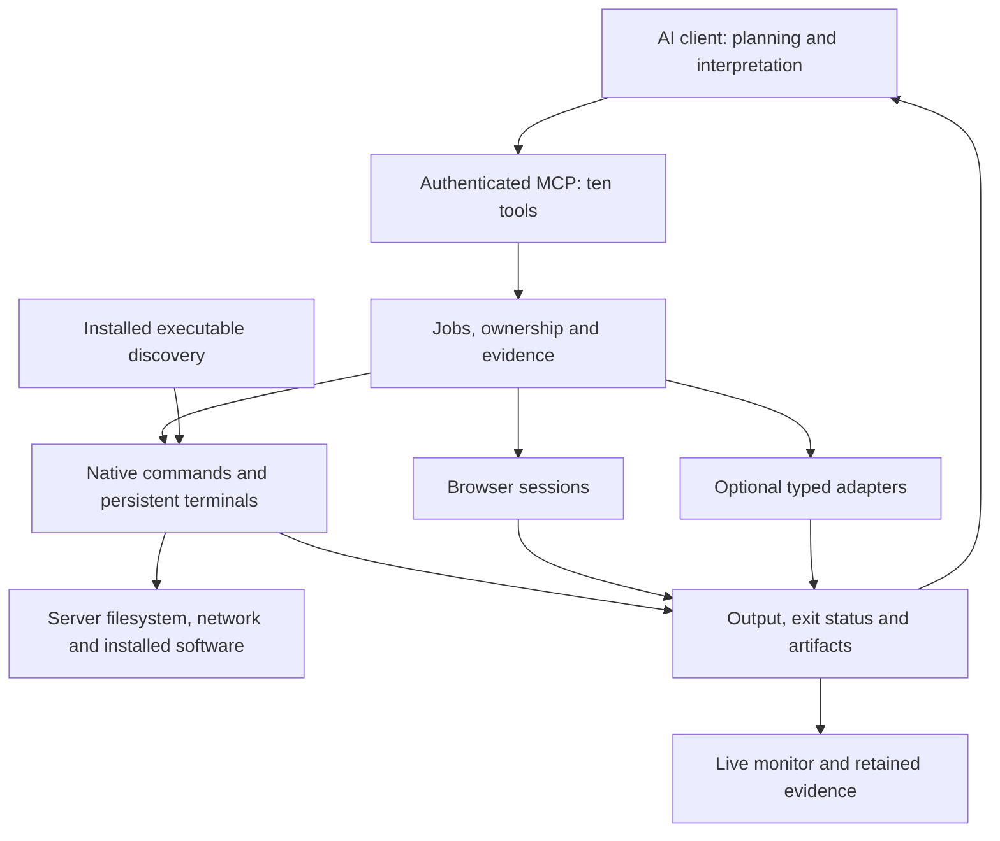

# Architecture

[README](../README.md) · [Configuration](CONFIGURATION.md)

## Controller and transports

`HexStrikeRuntime` coordinates engagement state, typed capabilities, execution, evidence and memory. MCP stdio embeds that runtime directly; it does not require a second HTTP process. Stdout is reserved for protocol frames. Network MCP authenticates requests and propagates the caller identity to runtime operations.

The HTTP MCP server also hosts telemetry and cancellation endpoints. The older Flask API is a compatibility interface; it is not an MCP endpoint. Both use the same execution and authorization services.

## Capabilities and execution

The compact MCP interface separates capability discovery from detailed schemas and execution. Adapters validate arguments, construct argv arrays and parse tool-specific output. The execution layer supervises process groups and verifies process identity before signalling. SSH workers transport structured arguments to a remote harness; the controller and its evidence remain on the initiating host unless the client invokes the controller itself over SSH.

Target selection and budgets are operator configuration, not embedded engagement policy. Authentication, argument validation and workspace confinement apply independently. Removing unsafe legacy command endpoints does not remove supported typed scanner operations.

Authenticated operators can use `execution.host` without registering a tool. It runs native argv or an explicitly requested shell with the server account's network and filesystem access. Typed adapters provide optional argument mapping and structured findings; they do not define the set of executable programs. Host execution does not promise target filtering or workspace confinement for child programs. MCP authentication protects entry to this trusted-operator interface. OS identity, privileges, filesystem mounts and network configuration determine its reach, including when the server itself runs inside a container.

The host harness offers batch jobs and durable pipe/PTY sessions with input, output cursors, resizing, timeouts and process-group cancellation. It reuses execution supervision and telemetry instead of adding a second job system. Native execution uses the existing server environment; isolated execution remains an explicit option.

## State and maintenance

Controller operations share a POSIX advisory lock outside the state directory. Backup and restore take an exclusive lock and refuse active jobs. This coordinates application writers across the database and workspace; it does not coordinate unrelated programs that edit state directly. Do not share writable state with an untrusted process.

Snapshots use SQLite's backup API and descriptor-relative copying of regular, singly linked files. Each snapshot has a unique directory and an integrity manifest. Restore verifies the snapshot in staging before replacing the state directory. A recovery journal prevents controllers from opening an empty directory after an interrupted replacement. Existing runtimes reject a replaced state directory and must restart.

Controllers and local monitors that share state must run on the same host and in the same PID namespace. Cross-container or remote monitors use authenticated telemetry instead.

## Memory

The memory service stores episodes, provenance and evaluated lessons in SQLite. Optional Graphiti integration provides local graph records and search. Query parsing is isolated from storage in `memory/cypher.py`. It implements an explicit read-only subset, not a general Cypher database. Candidate loading precedes filtering and aggregation; a presentation limit must not alter a count.

Local deterministic embeddings and search are retrieval mechanisms, not evidence of improved assessment accuracy. Lesson evaluation and cross-engagement visibility are separate operations.

## Verification boundaries

Regression tests cover transport authentication, path and argument boundaries, ownership, process cancellation, browser evidence, query semantics and state lifecycle. Loopback integration tests connect a real MCP client to the server and exercise terminal observation and cancellation. Wheel tests verify an isolated package entrypoint.

These checks do not certify every external tool release, AI client or deployment platform. Record actual environment and outcomes for deployment acceptance; do not replace that evidence with static pass tables or generated completion narratives.

## Durable contexts and result views

Execution uses backend-specific launch/termination logic in `execution.sandbox`; its process supervisor is independent of a stdio MCP lifetime. Control messages, status and bounded streams live outside the environment's writable mount. `execution.lifecycle` provides visibility and emergency cancellation. Container images are resolved at environment creation. Bubblewrap is an optional Linux backend with explicitly weaker aggregate resource guarantees, not the portable execution contract.

Interactive browser contexts use an independent asynchronous Playwright worker. This avoids blocking network callbacks during WebSocket policy decisions. Contexts retain authentication privately, route requests using current scope, and expose bounded DOM views and evidence handles. Browser isolation does not mean that all browser artifacts are nonsensitive; screenshots and downloaded content retain engagement access controls.

HTTP transaction construction and authentication storage are separate from adapter discovery. TLS verification remains enabled, credential references are origin-bound, cookies are partitioned by engagement/session/origin, and redirects are validated at every hop. Evidence storage keeps HAR/PNG artifacts separately from compact transport responses. Repeated identical findings retain review state and combine evidence; workflow parents reference child findings rather than creating duplicate records.

Capability verification executes explicit ground-truth cases through the ordinary job pipeline. Receipts carry implementation and executable identity and are invalidated when those identities change. CI exercises native platforms; optional backend tests run separately, and an unexecuted matrix entry is not a release-compatibility claim.

## Source layout

| Package | Responsibility |
| --- | --- |
| `cli`, `config` | Startup, saved settings, maintenance and client configuration |
| `transports` | MCP/HTTP endpoints, authentication and telemetry |
| `application`, `domain`, `policy` | Job coordination, models, ownership and operator-supplied scope |
| `registry`, `adapters` | Executable/capability discovery and optional typed tool integration |
| `execution` | Native/isolated processes, SSH workers and persistent sessions |
| `browser`, `http` | Browser contexts and HTTP transaction sessions |
| `workspace`, `evidence`, `reporting` | File operations, artifact storage and bounded result views |
| `memory`, `workflows` | Provenance retrieval and deterministic multi-step jobs |
| `tui` | Server dashboard and connection handoff |

The root Python entry points retain compatibility with existing integrations. They delegate to the modular package; the removed monolithic implementations are not shipped alongside it. Tests and benchmarks are development tooling, not runtime startup dependencies.
